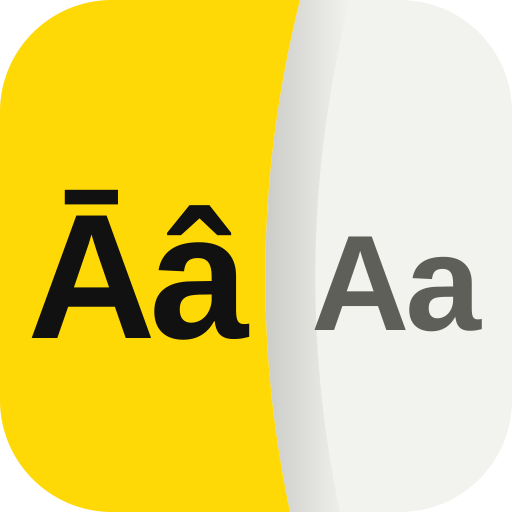
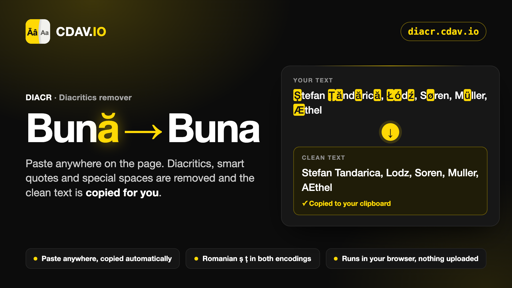

# DIACR, Diacritics Remover

**DIACR** ([diacr.cdav.io](https://diacr.cdav.io/)) is a free web tool by CDAV.IO that strips diacritics, smart quotes and invisible special spaces from text, so it can go into systems that mangle them: recruitment portals, old CRMs, CSV imports, email subject lines and file names.

It is built for Romanian text and the foreign names that appear in Romanian CVs. It is one HTML file with no dependencies. It runs entirely in your browser, makes no network requests and works when opened straight from disk.

## What it converts

Unicode NFD decomposition removes most accents (é, ñ, ç, ř and so on), but it silently misses several letters. Those get an explicit mapping, listed below. Case is preserved: uppercase in, uppercase out.

### Romanian

Both encodings are handled, because both are found in the wild.

| Character | Code point | Becomes | Note |
|---|---|---|---|
| ș Ș | U+0219, U+0218 | s S | Correct comma-below |
| ț Ț | U+021B, U+021A | t T | Correct comma-below |
| ş Ş | U+015F, U+015E | s S | Legacy cedilla |
| ţ Ţ | U+0163, U+0162 | t T | Legacy cedilla |
| ă Ă | U+0103, U+0102 | a A | |
| â Â | U+00E2, U+00C2 | a A | |
| î Î | U+00EE, U+00CE | i I | |

### Letters NFD does not decompose

| Character | Language | Becomes |
|---|---|---|
| ł Ł | Polish | l L |
| ø Ø | Danish, Norwegian | o O |
| đ Đ | Croatian, Serbian, Vietnamese | d D |
| ß ẞ | German | ss SS |
| æ Æ | Ligature | ae AE |
| œ Œ | Ligature | oe OE |
| ð Ð | Icelandic eth | d D |
| þ Þ | Icelandic thorn | th TH |
| ı | Turkish dotless i | i |
| İ | Turkish capital dotted I | I |
| å Å | Nordic | a A |
| ä ö ü Ä Ö Ü | German | a o u A O U |

A few extras are mapped as well: ħ, ŧ, ŀ, ij and the fi and fl ligatures.

### Typography

| Character | Becomes |
|---|---|
| Curly single quotes ‘ ’ ‚ and single guillemets ‹ › | ' |
| Curly double quotes “ ” „ and guillemets « » | " |
| En dash U+2013, em dash U+2014, minus sign U+2212, non-breaking hyphen U+2011, other dashes | - |
| Ellipsis U+2026 | ... |
| No-break space U+00A0, narrow no-break space U+202F, thin space U+2009 and other special spaces | a normal space |
| Zero-width space U+200B, zero-width joiners, word joiner, byte order mark, soft hyphen | removed |

Characters with no plain equivalent, such as € or Cyrillic letters, are left as they are and listed separately, so nothing disappears without you knowing.

## How to use it

1. Open `index.html` in any modern browser, or visit the published site.
2. Press Cmd + V (Mac) or Ctrl + V anywhere on the page. The text is cleaned and the result is **copied to your clipboard automatically**.
3. Paste it wherever you need it. You can also type in the left pane: the clean text updates on the right as you type, and Cmd + Enter or Ctrl + Enter copies it again.

Below the panes you can see how many characters went in and out, how many were changed, and exactly which characters were replaced and how many times.

Other controls:

- **Paste** reads your clipboard, cleans it and copies the result.
- **Upload .txt or .csv**, or drop a file on the left pane, cleans the file and downloads the result under the same file name. UTF-8 is expected, Windows-1250 files are read as a fallback.
- **Download** saves the current result.
- **Clear** empties both panes.
- The page opens in dark mode. The theme and language (English or Romanian) switches in the header are remembered in your browser.

The page header shows a short animation: more than 60 words with diacritics, from Bună to Smørrebrød, lose their marks one after another.

## Development

There is no build step. Edit `index.html` and reload. The conversion tests live in a comment at the top of the main script, one `TEST "input" => "expected"` line per case.

`netlify.toml` copies `index.html`, `404.html`, `icon.svg`, `preview.png`, `robots.txt` and `sitemap.xml` into a `dist` folder and publishes that. The site is meant to be served at `https://diacr.cdav.io/`. Point that subdomain at the Netlify site in your DNS settings.

The conversion function also supports two options that the page does not show: expanding German umlauts (ä to ae) and turning ß into s. They are covered by the tests.

## Security

Nothing you paste leaves your browser. See [SECURITY.md](SECURITY.md) for how the page handles your text and how to report a vulnerability.

## Links

- Bugs and ideas: [open an issue](https://github.com/CDAVIO/Diacritics-remover/issues/new)
- [cdav.io](https://cdav.io/), [GitHub](https://github.com/CDAVIO), [LinkedIn](https://www.linkedin.com/in/cristea-david/), [Instagram](https://www.instagram.com/cdav.io/)

## Licence

MIT. Copyright 2026 David Constantin Cristea (CDAV.IO). See [LICENSE](LICENSE).
